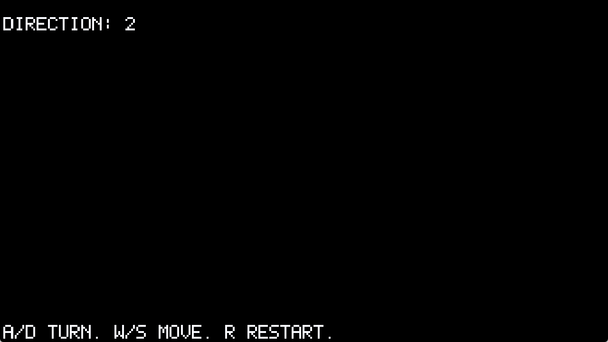

# 100% Darkness Maze

Author: Shangming Zhang

Design: You're lost in a pitch-black maze with no sight at all -- every footstep, every wall you bump into, and a faint bell marking the exit are the only information you get. Navigation is grid-locked (turn in fixed 90-degree steps, move one cell at a time) so that positional audio cues stay unambiguous even with zero visual reference.

Screen Shot:

How To Play:

- `A` / `D`: turn 90 degrees left/right
- `W` / `S`: step forward/backward one cell
- `R`: restart from the beginning
- There is nothing to see -- the screen stays black. Listen instead:
  - a footstep sound plays whenever you successfully move into an open cell
  - a bump sound plays instead if the cell ahead/behind is a wall
  - a distinct bell tone loops at the exit, getting louder as you approach
- Goal: reach the exit purely by ear. The current facing (1/2/3/4) is shown at the top of the screen as a reference.
- Tip: You may need a pencil and paper to draw the maze.

This game was built with [NEST](NEST.md).
